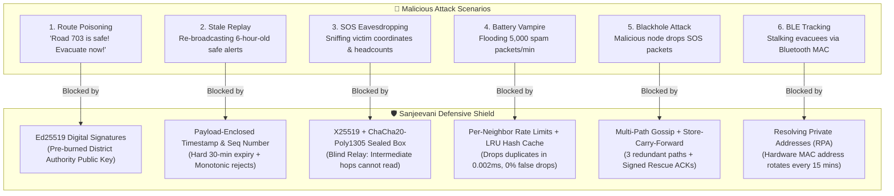

# Sanjeevani (ਸੰਜੀਵਨੀ) — Complete Cybersecurity & Zero-Trust Architecture Guide
**Hackathon:** CT BuildFest 2.0 (Powered by QuickHeal Academy)  
**Problem Statement:** CTBF-AI-12 · Autonomous Flood Early-Warning & Evacuation Advisor  
**Target Audience:** Beginner Developers, Team Presenters & Cyber Defense Judges  

---

## 📖 Table of Contents
1. [Why Cybersecurity Matters in a Flood App (The Life-or-Death Stake)](#1-why-cybersecurity-matters-in-a-flood-app)
2. [The Beginner's Cyber Dictionary (Plain English & Real-World Analogies)](#2-the-beginners-cyber-dictionary)
3. [The Threat Model: Who is the Attacker?](#3-the-threat-model-who-is-the-attacker)
4. [The 6 Real Attacks & How Sanjeevani Stops Them](#4-the-6-real-attacks--how-sanjeevani-stops-them)
   - [Attack 1: The "Bridge is Safe!" Fake Broadcast (Route Poisoning)](#attack-1-the-bridge-is-safe-fake-broadcast-route-poisoning)
   - [Attack 2: The "Yesterday's Warning" Stale Replay Attack](#attack-2-the-yesterdays-warning-stale-replay-attack)
   - [Attack 3: The "Spying on Victims" SOS Eavesdropping Attack](#attack-3-the-spying-on-victims-sos-eavesdropping-attack)
   - [Attack 4: The "Battery Vampire" Spam Flood (Denial of Service)](#attack-4-the-battery-vampire-spam-flood-denial-of-service)
   - [Attack 5: The "Silent Traitor" Packet Drop (Blackhole Attack)](#attack-5-the-silent-traitor-packet-drop-blackhole-attack)
   - [Attack 6: The "Bluetooth Stalker" Tracking Attack](#attack-6-the-bluetooth-stalker-tracking-attack)
5. [Judge Traps: What Beginners Get Wrong vs. What We Built](#5-judge-traps-what-beginners-get-wrong-vs-what-we-built)
6. [The 30-Second QuickHeal Pitch (Memorize This)](#6-the-30-second-quickheal-pitch)
7. [Judge Q&A Roleplay: Exact Word-for-Word Answers](#7-judge-qa-roleplay-exact-word-for-word-answers)

---

## 1. Why Cybersecurity Matters in a Flood App

When most developers build a flood app, they only think about:
- *"Can I show a pretty blue map?"*
- *"Can I show a weather card?"*

**QuickHeal Academy judges do not care about pretty colors.** QuickHeal is a multi-million-dollar cybersecurity company. Their judges look at a disaster app and ask:
> *"If an evil person stands in the flooded village with a laptop and a radio transmitter, can they kill people by manipulating this app?"*

Think about what happens in a real Punjab flood (like July 2023 along the Satluj river):
- Cellular towers lose power and drown. Fiber internet lines snap.
- People have **zero internet** and **5% battery** left on their budget Android phones.
- To share evacuation routes, phones must talk directly to neighboring phones using **Bluetooth Low Energy (BLE)** and **Wi-Fi Direct** like a bucket brigade (a Peer-to-Peer Mesh Network).
- **The danger:** If anyone can jump into this wireless chain, an attacker could broadcast:
  - *"Go south! Highway 703 is completely dry!"* — sending 500 tractors straight into a 10-foot submerged breach.
  - Or, an attacker could steal women and children's GPS locations from distress beacons.

That is why Sanjeevani is built on **Zero-Trust**: we assume every radio signal, every relay phone, and every mesh neighbor is potentially untrusted.

---

## 2. The Beginner's Cyber Dictionary

If technical terms make your head spin, read this section. Everything is explained with real-world analogies:

### 1. Hash (Digital Fingerprint)
- **Plain English:** A one-way mathematical function that takes any piece of data (a photo, a message, a route) and turns it into a unique, fixed 64-character code (like `e3b0c44298fc1c149...`).
- **Real-World Analogy:** A human fingerprint. If you change a single pixel or a single comma in the document, the fingerprint changes completely. You can never turn the fingerprint back into the original text.
- **Tools we use:** SHA-256 and Blake2b.

### 2. Symmetric vs. Asymmetric Encryption
- **Symmetric Encryption (The Diary Lock):** You lock a box with a key, and your friend uses the **exact same key** to unlock it. 
  - *Problem in disasters:* How do you give your friend the secret key if there is no internet to send it secretly? If a hacker steals the key, they can open everything.
- **Asymmetric Encryption (The Public Mailbox):** There are **two keys**:
  1. A **Public Key** (the slot in the mailbox): Anyone in the village can drop an envelope in.
  2. A **Private Key** (the postman's key): Only the official rescue team has the key to unlock the back of the box and read the envelopes.
  - *Tools we use:* **X25519** for encryption, **Ed25519** for signatures.

### 3. Digital Signature (The King's Wax Seal)
- **Plain English:** A cryptographic stamp placed on an official message.
- **Real-World Analogy:** The King presses his unique royal ring into hot red wax on an evacuation order. Anyone in the kingdom can look at the wax and recognize the King's seal. But nobody can forge the seal without stealing the King's ring.
- **Rule to remember:** Signatures prove **integrity** (nobody changed the words) and **authenticity** (it came from the King). They do NOT hide the message (everyone can read the King's announcement).

### 4. Authenticated Encryption / AEAD (Sealed Armored Box)
- **Plain English:** Hiding a message so only the receiver can read it, AND adding a tamper-evident seal so nobody can secretly tamper with the scrambled text.
- **Real-World Analogy:** You put your medical info inside a steel safe, lock it, and wrap a tamper-evident holographic wire around the lock. If an evil courier tries to scramble the contents or swap digits, the wire snaps and the hospital rejects it.
- **Tools we use:** **ChaCha20-Poly1305** or **AES-256-GCM**.

### 5. Replay Attack (Re-using Yesterday's Movie Ticket)
- **Plain English:** A hacker doesn't need to break your encryption. They simply record a genuine message from 6 hours ago and blast it again now.
- **Real-World Analogy:** The DC office sent a genuine signed message at 9:00 AM saying *"Bridge X is dry."* At 2:00 PM, the bridge breaks and drowns. The hacker takes the 9:00 AM message and replays it at 3:00 PM. The signature is genuine, but the information is deadly stale!

### 6. Sybil Attack (The Many-Faced Troll)
- **Plain English:** One single person creates 100 fake virtual identities on a network to pretend a whole mob agrees with them.
- **Real-World Analogy:** One rogue guy in a room wearing 50 different fake mustaches, voting 50 times that *"There is no flood, go back to bed!"*

### 7. Denial of Service (DoS) & Vampire Attack
- **Plain English:** Flooding a device with so much garbage traffic that its battery drains or its processor crashes.
- **Real-World Analogy:** Someone ringing your doorbell 500 times a minute while you are trying to pack your bags to escape a flood. Your phone burns 100% of its remaining battery just checking the garbage messages.

### 8. Blackhole Attack (The Rogue Postman)
- **Plain English:** A malicious phone agrees to be part of the mesh network, receives SOS messages from drowning neighbors, and silently deletes them instead of forwarding them.

---

## 3. The Threat Model: Who is the Attacker?

To defend a system, you must know what the enemy has:

| Property | Civilian Evacuee | The Rogue Attacker |
| :--- | :--- | :--- |
| **Device** | \$80 Budget Android Phone | High-end Laptop with NVIDIA GPU |
| **Battery** | 8% remaining, no electricity | 12V Car Battery / Portable Generator |
| **Radio** | Low-power Bluetooth chip (10m range) | High-gain directional antenna (1 km range) |
| **Goal** | Reach high ground safely with family | Cause panic, redirect lootable farms, steal data |

---

## 4. The 6 Real Attacks & How Sanjeevani Stops Them



---

### Attack 1: The "Bridge is Safe!" Fake Broadcast (Route Poisoning)
- **The Threat:** A rogue actor injects a fake radio broadcast telling citizens that a flooded bridge is open, leading them into floodwaters.
- **Sanjeevani's Defense: Ed25519 Asymmetric Digital Signatures.**
  - Official evacuation orders, dam discharge figures, and shelter openings are cryptographically signed at the District Disaster Management Authority (DDMA / Jalandhar DC Office) using a **Private Signing Key**.
  - Sanjeevani comes with the DDMA's **Public Verification Key** embedded inside the app code.
  - When your phone receives a mesh broadcast offline, it runs a client-side signature check.
  - If a hacker alters even a single word or coordinate, the signature check fails mathematically, and your phone **silently deletes the packet**. The app's Dijkstra navigation will never suggest an unsigned road.

---

### Attack 2: The "Yesterday's Warning" Stale Replay Attack
- **The Threat:** The government genuinely signed an alert at 8:00 AM saying *"Lohian Khas causeway is passable."* At 1:00 PM, the Dhussi Bandh breaches and submerges the road. The hacker records the 8:00 AM alert and rebroadcasts it at 2:00 PM. The digital signature is 100% genuine, but the road is underwater!
- **Sanjeevani's Defense: Payload-Enclosed Temporal Bounds.**
  - A signature alone does NOT prevent replay. 
  - Sanjeevani solves this by packaging the timestamp, an incremental sequence number, and a strict expiration window **inside the signed payload**:
    ```json
    {
      "sequenceNumber": 1042,
      "issuedAt": 1793281200,
      "expiresAt": 1793283000,
      "safeRoadId": "SH_25_ELEVATED",
      "evacuationStatus": "MANDATORY_24H"
    }
    ```
  - When a civilian's phone receives this message, it verifies two rules:
    1. Is `expiresAt < currentTime`? If yes, **discard as expired**.
    2. Is `sequenceNumber <= lastSeenSequenceNumber`? If yes, **discard as stale replay**.

---

### Attack 3: The "Spying on Victims" SOS Eavesdropping Attack
- **The Threat:** When an isolated family taps the red SOS button, an eavesdropper sitting 300 meters away with an antenna intercepts the radio packet to see which farmhouses have elderly people or unattended cattle.
- **Sanjeevani's Defense: Authenticated Sealed-Box Encryption (X25519 + ChaCha20-Poly1305).**
  - Notice the crucial technical distinction: **Ed25519 is for signatures; X25519 is for encryption.**
  - When the victim taps SOS, the app uses **X25519 Diffie-Hellman Key Exchange** and **ChaCha20-Poly1305** to seal the GPS coordinates, patient medical needs, and family headcount into an encrypted envelope addressed *only* to the NDRF / Civil Hospital public key.
  - Intermediate phones in the mesh act as **"Blind Relays"**: they receive the encrypted packet, hold it, and pass it to the next phone without ever being able to read inside it.
  - The Poly1305 authentication tag guarantees that if any relay tries to change even one bit of the ciphertext, the rescue base-station detects the tampering immediately.

---

### Attack 4: The "Battery Vampire" Spam Flood (Denial of Service)
- **The Threat:** An attacker writes a Python script on their laptop to blast 10,000 fake SOS beacons every second. This overwhelms the Bluetooth chips of nearby phones, draining their batteries to 0% in minutes.
- **Sanjeevani's Defense: The 4-Layer Friction Shield.**
  1. **Micro Proof-of-Work (PoW):** To send an SOS, the sending phone must calculate a tiny cryptographic hash with 1 leading zero (Hashcash). It takes a normal victim's phone 3 milliseconds to generate one SOS, but forces a spammer trying to send 10,000 packets per second to overheat and throttle their transmitter.
  2. **Per-Neighbor Token Bucket Rate Limiting:** Every relay node maintains a local rate limiter: it accepts a maximum of **5 packets per minute from any single physical neighbor**. Any extra packets are dropped at the radio firmware level.
  3. **Exact LRU Packet-Hash Cache (Zero False Positives):**
     - Beginners often suggest "Bloom filters" here, but Bloom filters have false positives that could mistakenly drop a drowning person's real SOS.
     - Instead, Sanjeevani maintains an in-memory **Least-Recently-Used (LRU) Cache of exact 32-byte Blake2b packet hashes**. If a phone has seen this exact packet before, it drops it in **0.002 milliseconds** without waking up the screen or CPU.
  4. **Rescue-Side Spatial Corroboration:** When packets reach the rescue team, a clustering algorithm checks if reports from a 500-meter radius corroborate each other. Clustered reports get emergency dispatch; isolated single-device anomalies are deprioritized for secondary verification.

---

### Attack 5: The "Silent Traitor" Packet Drop (Blackhole Attack)
- **The Threat:** A hostile or corrupted device sits between the village and the rescue base. It accepts packets from victims, smiles, and silently throws them in the trash instead of forwarding them.
- **Sanjeevani's Defense: Multi-Path Epidemic Gossip + Store-Carry-Forward + Signed ACKs.**
  - **Multi-Path ($k=3$):** Sanjeevani never sends an SOS along a single line. It broadcasts to **3 random distinct neighbors** simultaneously. Even if one neighbor is a blackhole, the other two paths propagate.
  - **Store-Carry-Forward (Delay-Tolerant Networking / DTN):** If a village cluster is completely cut off by a 2 km lake of floodwater, tractors and rescue boats act as "data mules"—their phones store the packets in local flash memory, and automatically forward them when they drive close to a new cluster of phones.
  - **Signed Delivery Acknowledgments (ACKs):** When the rescue boat terminal receives an SOS, it signs an official "Rescue Dispatched" receipt and gossips it backwards along the mesh. If the victim's phone doesn't get an ACK within 15 minutes, it rebroadcasts along alternative channels.

---

### Attack 6: The "Bluetooth Stalker" Tracking Attack
- **The Threat:** Every phone's Bluetooth chip has a hardware MAC address (like a digital license plate). An attacker places radio sniffers along a levee road to monitor which villagers are fleeing and where they are going.
- **Sanjeevani's Defense: Ephemeral Resolving Private Addresses (RPA).**
  - Sanjeevani utilizes the Bluetooth Core Specification's **Resolving Private Addresses (RPA)**.
  - The phone's broadcasted Bluetooth MAC address automatically **rotates to a completely random number every 15 minutes**.
  - All transmission payloads also use rolling random ephemeral transaction IDs, making physical tracking and traffic pattern analysis impossible.

---

## 5. Judge Traps: What Beginners Get Wrong vs. What We Built

When QuickHeal judges grill hackathon teams, 95% of students fall into these traps. Here is how we prove we are different:

| # | What an Amateur Says (Instant Loss of Aura) | What Sanjeevani Does (QuickHeal Grade) | Why It Matters |
| :--- | :--- | :--- | :--- |
| **1** | *"Our Proof-of-Work makes spam computationally impossible!"* | *"PoW raises the baseline friction, layered with per-neighbor token bucket rate limits and rescue-side corroboration."* | A hacker with a laptop GPU can crack phone-level PoW easily. PoW is friction, not a silver bullet. |
| **2** | *"Digital signatures protect against replay attacks!"* | *"Signatures protect data integrity; payload-enclosed sequence numbers and expiry timestamps protect against stale replay."* | An attacker can replay an old, validly signed message. Freshness must be inside the signed envelope. |
| **3** | *"We encrypt the SOS messages with Ed25519."* | *"We sign advisories with Ed25519; we encrypt SOS distress payloads with X25519 and ChaCha20-Poly1305."* | Ed25519 is strictly a signature scheme. Confusing signing with encryption is a giveaway of copied buzzwords. |
| **4** | *"A signed citizen SOS proves the person is real."* | *"A citizen keypair proves packet integrity, not identity. Anti-Sybil is handled by 3-device spatial corroboration."* | Anyone can generate a keypair. Signatures prevent tampering, not fake accounts. |
| **5** | *"We use a Bloom filter to prevent duplicate packets."* | *"We use an exact 32-byte Blake2b hash LRU cache with 0% false positives."* | Bloom filters have false positives. In a flood, a false positive means dropping a drowning person's real SOS. |
| **6** | *"Our mesh is 100% unhackable."* | *"We admit physical limits like radio jamming and packet drops, which we mitigate with multi-path redundancy and ACKs."* | Security professionals know nothing is unhackable. Admitting real limits and defending against them earns top scores. |

---

## 6. The 30-Second QuickHeal Pitch

*(Practice saying this smoothly in 30 seconds. This is your secret weapon):*

> *"Yes, any open wireless mesh can be attacked, so Sanjeevani assumes all intermediate relays are untrusted.*
>
> *First, **official advisories** are signed using **Ed25519** and strictly encapsulate a timestamp, sequence number, and expiry window inside the signed payload—so tampering and stale replay attacks both fail.*
>
> *Second, **civilian SOS payloads** use authenticated encryption (**X25519 with ChaCha20-Poly1305 sealed box**) keyed to the rescue authority’s public key. Relays are blind couriers: they cannot inspect, deanonymize, or flip bits in the distress packet.*
>
> *Against **spam and battery drain**, we don't claim PoW is an impenetrable wall; we combine micro-PoW with per-neighbor rate limits, an exact LRU packet-hash cache (zero false drops), and rescue-side spatial corroboration.*
>
> *Our known limits are RF jamming and malicious relays silently dropping packets, which we mitigate with multi-path epidemic gossip, store-carry-forward delay-tolerant routing, and signed delivery ACKs."*

---

## 7. Judge Q&A Roleplay: Exact Word-for-Word Answers

### ❓ Question 1: *"How does a villager get the rescue team's public key if all towers and internet are destroyed?"*
> **Your Answer:**  
> *"The public verification keys are pre-provisioned directly inside the Sanjeevani application bundle during initial installation. For uninstalled citizens arriving at local staging camps or high-ground relief tents, the PWA bundle and public keys are distributed locally via zero-data Wi-Fi Direct hotspots and printed physical QR codes on bulletin boards."*

### ❓ Question 2: *"What happens if a rescue officer drops their phone in the water or it gets stolen by an adversary?"*
> **Your Answer:**  
> *"First, all rescue private keys are locked inside the hardware Secure Enclave / Android Keystore, requiring biometric or PIN authentication. Second, our protocol includes a `Key-ID` header and an emergency **Key Revocation Certificate** signed by the District Magistrate's master authority key. The revocation certificate is flooded across the mesh to invalidate that key ID across all offline nodes."*

### ❓ Question 3: *"Why not just use Starlink / Satellite internet instead of this peer-to-peer mesh?"*
> **Your Answer:**  
> *"Satellite terminals cost \$500+, require an open view of the sky (which fails under monsoon cloudbursts and thick village tree canopies), and draw 50–100 watts of continuous electrical power. In rural Punjab floods, power grids fail for days. Sanjeevani operates on existing \$80 smartphones using low-energy Bluetooth (BLE) and Wi-Fi Direct without requiring a single rupee of new hardware."*

### ❓ Question 4: *"In a sparse village where houses are 500 meters apart, won't packets get stuck?"*
> **Your Answer:**  
> *"If the mesh is partitioned, we switch from real-time flooding to **Delay-Tolerant Networking (DTN) with Store-Carry-Forward**. Moving nodes—like rescue dinghies, tractors, and livestock herders—buffer packets in their local phone storage and automatically forward them when they encounter a new peer cluster."*

### ❓ Question 5: *"If nodes buffer packets, won't their phone storage fill up?"*
> **Your Answer:**  
> *"Packets have a strict Time-To-Live (TTL = 6 hops or 3 hours). The local emergency buffer is capped at 5 MB (which can hold over 15,000 compressed SOS envelopes). An LRU eviction policy automatically purges expired packets, prioritizing unacknowledged SOS beacons over general river telemetry."*

---

*Document compiled for CT BuildFest 2.0 · QuickHeal Academy Cyber Defense Track · All Rights Reserved.*
